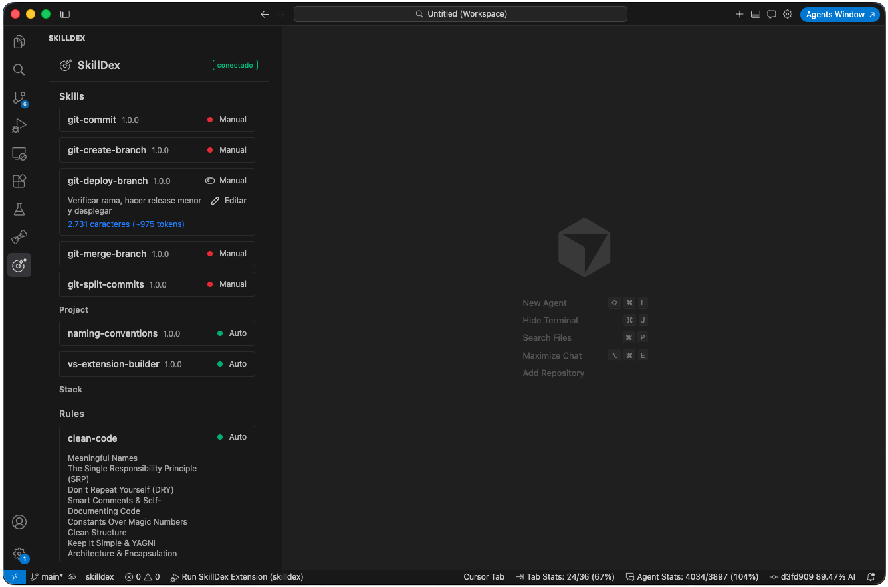

# SkillDex

<div align="center">

</div>

La extensión para Cursor para manejar **Rules** y **Skills** de IA.

Descubre todo el catálogo de herramientas IA y lo muestra en un práctico dashboard donde puedes llevar el control de todas las herramientas. Activa y desactiva skills, conoce su peso antes usarlas y ordenalas por categorías.

## Requisitos

- Cursor `^1.85.0`
- Para desarrollo y empaquetado: **Node.js >= 18**

## Instalación (VSIX)

1. Genera el paquete (o [descárgate el generado](https://github.com/Kiyameh/skilldex/raw/main/download/skilldex-1.0.0.vsix)):

   ```bash
   npm install
   npm run package
   ```

   Se crea `download/skilldex-1.0.0.vsix`.

2. En Cursor: paleta de comandos (F1)
3. Escribe **Extensions: Install from VSIX…** → elige `download/skilldex-1.0.0.vsix`.
4. Recarga la ventana si el editor lo pide.

Para desinstalar: Extensions → SkillDex → Uninstall.

## Uso

1. Abre un workspace con `.cursor/rules/` y/o `.cursor/skills/`.
2. Abre el panel:
   - icono **SkillDex** en la barra lateral, o
   - comando **SkillDex: Abrir SkillDex**.

## Features

### Skills

- Skills ordenadas por categorías ❖ Organiza tus skills en directorios dentro de `.cursor/skills/` para categorizarlas
- Nombre y descripción
- Versión de la skill ❖ Añade en tus skills para llevar el control de versiones:

```markdown
metadata:
version: "1.0.0"
```

- Switch de invocación manual o automatica ❖ Maneja `disable-model-invocation: true` desde el panel
- Peso y tokens ❖ Calculado automaticamente caracteres de la skill y gasto apróximado al usarla en un prompt

### Rules

- Lista de rules aplicadas en el proyecto
- Switch de `alwaysApply: true` desde el panel
- Secciones (titulos h2 del markdown) de cada archivo de rules
- Globs ❖ Identifica rapidamente sobre que tipo de archivo se está aplicando cada regla

## Desarrollo

```bash
npm install
npm run build          # Host (tsc) + Webview (Vite)
npm run watch          # Watch Host + Webview
```

1. Abre este repositorio en Cursor / VS Code.
2. Pulsa **F5** (_Run SkillDex Extension_) para lanzar el Extension Development Host.
3. En la ventana nueva, usa el icono SkillDex o el comando de paleta.

### Scripts útiles

```bash
npm run compile         # Solo Extension Host
npm run build:webview   # Solo Webview
npm run typecheck
npm run test:unit       # Vitest
npm run test:integration
npm test                # unit + integration
npm run lint
npm run format
npm run package         # Build + generar .vsix
```

### Estructura

- `src/extension/` — Extension Host (TypeScript strict)
- `src/webview/` — UI React + Vite + Tailwind
- `src/shared/` — tipos y contrato Host ↔ Webview
- `out/` — salida compilada del Host
- `dist/webview/` — assets estáticos del Webview
- `media/` — iconos (Activity Bar, UI)

### Tests

Pirámide local: unitarios colocalizados (`*.test.ts` / `*.test.tsx` con Vitest) e integración (`*.integration.test.ts` con `@vscode/test-cli`).

## Empaquetado

`npm run package` ejecuta `vscode:prepublish` (build completo) y empaqueta con `@vscode/vsce`.

El fichero `.vscodeignore` es imprescindible: sin él, vsce heredaría `.gitignore` y **excluiría** `out/` y `dist/`, dejando un VSIX sin Host ni Webview (panel en blanco).

Comprobar el contenido antes de instalar:

```bash
npx vsce ls
```

Debe incluir `out/extension/extension.js`, `dist/webview/index.html` (y assets), `media/*` y la dependencia runtime `gray-matter`. No debe incluir `src/` ni `openspec/`.

## Licencia

MIT © Andoni Gallardo
